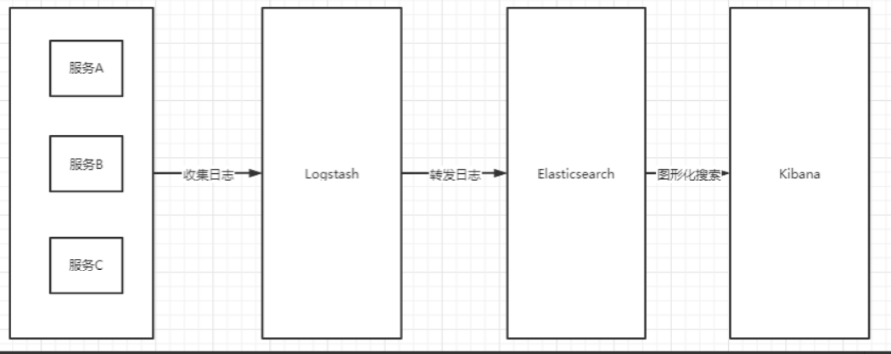
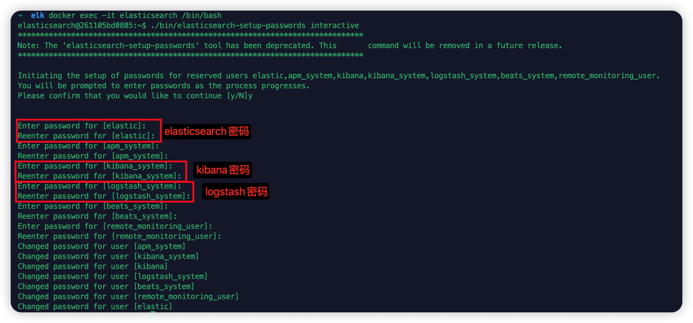
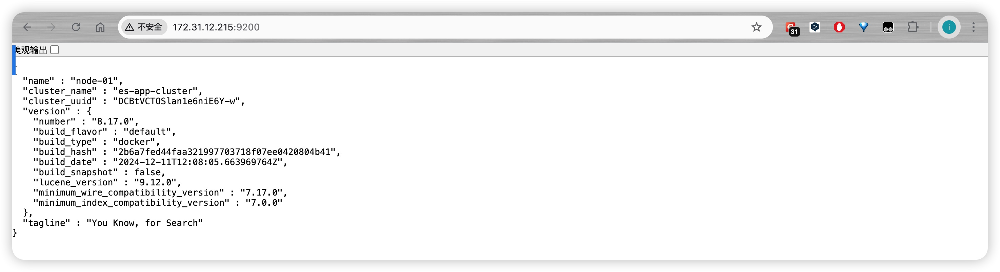

## Docker 构建 ELK（docker-compose 部署版本）

## ELK 架构

+ Elasticsearch：开源分布式搜索引擎，提供搜集、分析、存储数据三大功能。
+ Logstash：日志的搜集、分析、过滤工具，支持大量的数据获取方式。
+ Kibana：为 Logstash 和 Elasticsearch 提供友好的日志分析 Web 界面，帮助汇总、分析和搜索重要数据日志。



本文按 docker-compose 方式部署 **Elasticsearch + Kibana + Logstash** 三件套，镜像、端口、密码、目录、容器名等可配置项全部集中在 `.env` 中管理，其余配置项放在 `ELK_CONF_DIR` 下（默认 `/data/runtime/docker/elk/conf`）。

## 1. 宿主目录

| 宿主目录 | 用途 | 容器内用户 |
|---------|------|-----------|
| `/data/runtime/docker/elk/elasticsearch/data` | ES 数据 | uid 1000 |
| `/data/runtime/docker/elk/elasticsearch/logs` | ES 日志 | uid 1000 |
| `/data/runtime/docker/elk/elasticsearch/plugins` | ES 插件 | uid 1000 |
| `/data/runtime/docker/elk/kibana/data` | Kibana 数据 | uid 1000 |
| `/data/runtime/docker/elk/kibana/logs` | Kibana 日志 | uid 1000 |
| `/data/runtime/docker/elk/logstash/data` | Logstash 数据 | uid 1000 |
| `/data/runtime/docker/elk/conf` | 配置文件（elasticsearch/kibana/logstash.yml、pipeline/） | 只读 |

> 数据目录：`.env` 中 `*_DATA_DIR` 等留空则回退使用 Docker 命名卷；**配置目录 `ELK_CONF_DIR` 为必填**，需先按第 2 节复制配置。

## 2. 创建宿主目录并设置权限

bind mount 首次使用需先建目录并授权（es/kibana/logstash 容器内用户 uid 1000）：

```bash
# 1) 配置目录：首次部署把部署包 conf/ 复制到宿主根，之后直接修改宿主目录下的配置
mkdir -p /data/runtime/docker/elk/conf
cp -r ./conf/. /data/runtime/docker/elk/conf/

# 2) 数据目录
mkdir -p /data/runtime/docker/elk/{elasticsearch/{data,logs,plugins},kibana/{data,logs},logstash/data}
chown -R 1000:1000 /data/runtime/docker/elk
```

## 3. 编制 .env

在本目录创建 `.env` 文件（内容如下，按需修改）：

```bash
# ---------- ELK 环境变量（集中管理） ----------

# ===== 镜像配置 =====
ELASTIC_IMAGE=elasticsearch:8.17.0
KIBANA_IMAGE=kibana:8.17.0
LOGSTASH_IMAGE=logstash:8.17.0

# ===== 容器名 =====
ELASTIC_CONTAINER_NAME=elasticsearch
KIBANA_CONTAINER_NAME=kibana
LOGSTASH_CONTAINER_NAME=logstash

# ===== 宿主机端口（宿主机:容器）=====
ELASTIC_PORT=9200
ELASTIC_TRANSPORT_PORT=9300
KIBANA_PORT=5601
LOGSTASH_PORT=4560

# ===== 密码（elastic 用户密码在首次启动时按 ELASTIC_PASSWORD 自动设置）=====
ELASTIC_PASSWORD=elastic
KIBANA_PASSWORD=elastic
LOGSTASH_PASSWORD=elastic

# ===== 宿主机数据目录（统一约定 /data/runtime/docker/<服务>）；留空则回退到命名卷 =====
ELASTIC_DATA_DIR=/data/runtime/docker/elk/elasticsearch/data
ELASTIC_LOGS_DIR=/data/runtime/docker/elk/elasticsearch/logs
ELASTIC_PLUGINS_DIR=/data/runtime/docker/elk/elasticsearch/plugins
KIBANA_DATA_DIR=/data/runtime/docker/elk/kibana/data
KIBANA_LOGS_DIR=/data/runtime/docker/elk/kibana/logs
LOGSTASH_DATA_DIR=/data/runtime/docker/elk/logstash/data
ELK_CONF_DIR=/data/runtime/docker/elk/conf
TZ=Asia/Shanghai
```

## 4. .env 变量说明

| 变量 | 说明 | 示例 |
|------|------|------|
| `ELASTIC_IMAGE` / `KIBANA_IMAGE` / `LOGSTASH_IMAGE` | 镜像版本 | `elasticsearch:8.17.0` 等 |
| `ELASTIC_PORT` / `ELASTIC_TRANSPORT_PORT` | ES HTTP / 节点通信端口 | `9200` / `9300` |
| `KIBANA_PORT` | Kibana 端口 | `5601` |
| `LOGSTASH_PORT` | Logstash TCP 输入端口 | `4560` |
| `ELASTIC_PASSWORD` / `KIBANA_PASSWORD` / `LOGSTASH_PASSWORD` | 各组件访问 ES 的密码 | `elastic` |
| `ELASTIC_DATA_DIR` 等 | 数据目录，留空回退命名卷 | `/data/runtime/docker/elk/...` |
| `ELK_CONF_DIR` | 配置目录（必填，先复制 conf/） | `/data/runtime/docker/elk/conf` |
| `TZ` | 时区 | `Asia/Shanghai` |

## 5. docker-compose.yml

在本目录创建 `docker-compose.yml`：

```yaml
services:
  elasticsearch:
    image: ${ELASTIC_IMAGE}
    container_name: ${ELASTIC_CONTAINER_NAME}
    restart: always
    environment:
      - ELASTIC_PASSWORD=${ELASTIC_PASSWORD}
      - "ES_JAVA_OPTS=-Xms1g -Xmx1g"   # Xms 必须等于 Xmx
      - TZ=${TZ}
    ulimits:
      memlock:
        soft: -1
        hard: -1
    ports:
      - "${ELASTIC_PORT}:9200"
      - "${ELASTIC_TRANSPORT_PORT}:9300"
    volumes:
      - ${ELK_CONF_DIR}/elasticsearch.yml:/usr/share/elasticsearch/config/elasticsearch.yml
      - ${ELASTIC_DATA_DIR:-es-data}:/usr/share/elasticsearch/data
      - ${ELASTIC_LOGS_DIR:-es-logs}:/usr/share/elasticsearch/logs
      - ${ELASTIC_PLUGINS_DIR:-es-plugins}:/usr/share/elasticsearch/plugins
      - /etc/localtime:/etc/localtime:ro
    networks:
      - elk-network

  kibana:
    image: ${KIBANA_IMAGE}
    container_name: ${KIBANA_CONTAINER_NAME}
    restart: always
    environment:
      - ELASTICSEARCH_HOSTS=http://elasticsearch:9200
      - ELASTICSEARCH_USERNAME=kibana_system
      - ELASTICSEARCH_PASSWORD=${KIBANA_PASSWORD}
      - TZ=${TZ}
    ports:
      - "${KIBANA_PORT}:5601"
    volumes:
      - ${ELK_CONF_DIR}/kibana.yml:/usr/share/kibana/config/kibana.yml
      - ${KIBANA_DATA_DIR:-kb-data}:/usr/share/kibana/data
      - ${KIBANA_LOGS_DIR:-kb-logs}:/usr/share/kibana/logs
      - /etc/localtime:/etc/localtime:ro
    depends_on:
      - elasticsearch
    networks:
      - elk-network

  logstash:
    image: ${LOGSTASH_IMAGE}
    container_name: ${LOGSTASH_CONTAINER_NAME}
    restart: always
    environment:
      - LOGSTASH_ELASTICSEARCH_PASSWORD=${LOGSTASH_PASSWORD}
      - TZ=${TZ}
    ports:
      - "${LOGSTASH_PORT}:4560"
    volumes:
      - ${ELK_CONF_DIR}/logstash.yml:/usr/share/logstash/config/logstash.yml
      - ${ELK_CONF_DIR}/pipelines.yml:/usr/share/logstash/config/pipelines.yml
      - ${ELK_CONF_DIR}/pipeline:/usr/share/logstash/pipeline
      - ${LOGSTASH_DATA_DIR:-ls-data}:/usr/share/logstash/data
      - /etc/localtime:/etc/localtime:ro
    depends_on:
      - elasticsearch
    networks:
      - elk-network

networks:
  elk-network:
    driver: bridge
```

## 6. 设置密码（首次启动必须）

镜像默认开启 xpack 安全（`xpack.security.enabled=true`，见 `${ELK_CONF_DIR}/elasticsearch.yml`）。首次启动后，为内置用户统一设置密码：

```bash
# 进入 elasticsearch 容器
docker exec -it elasticsearch /bin/bash
# 交互式设置所有内置用户密码（最低 6 个字符，可统一设为 elastic）
./bin/elasticsearch-setup-passwords interactive
# 退出并重启服务
exit
docker restart elasticsearch
```



然后把设置的密码同步到 `.env` 的 `ELASTIC_PASSWORD` / `KIBANA_PASSWORD` / `LOGSTASH_PASSWORD`，再执行 `docker compose up -d` 重建 kibana / logstash。

## 7. 启动

```bash
cd Docker构建ELK
docker compose up -d
docker compose ps
docker compose logs -f
docker compose down        # 停止并移除容器（命名卷数据保留）
docker compose down -v     # 连数据卷一起清空
```

## 8. 验证

浏览器请求: `http://<服务器IP>:9200`（需携带账号密码验证）



Kibana 控制台: `http://<服务器IP>:5601`

### 管道示例（`${ELK_CONF_DIR}/pipeline/test.conf`）

Logstash 监听 TCP 4560 端口，把收到的日志写入 Elasticsearch：

```conf
input {
  tcp {
    mode => "server"
    host => "0.0.0.0"
    port => 4560
  }
}

output {
  elasticsearch {
    hosts => ["http://elasticsearch:9200"]
    user => "elastic"
    password => "${LOGSTASH_ELASTICSEARCH_PASSWORD}"
    index => "logstash-%{+YYYY.MM.dd}"
  }
  stdout { codec => rubydebug }
}
```

> `logstash.yml` 已开启 `config.reload.automatic: true`，修改管道文件后自动热加载，无需重启。
