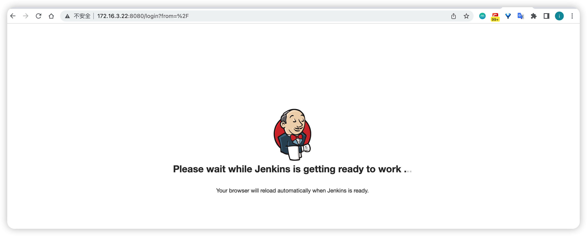
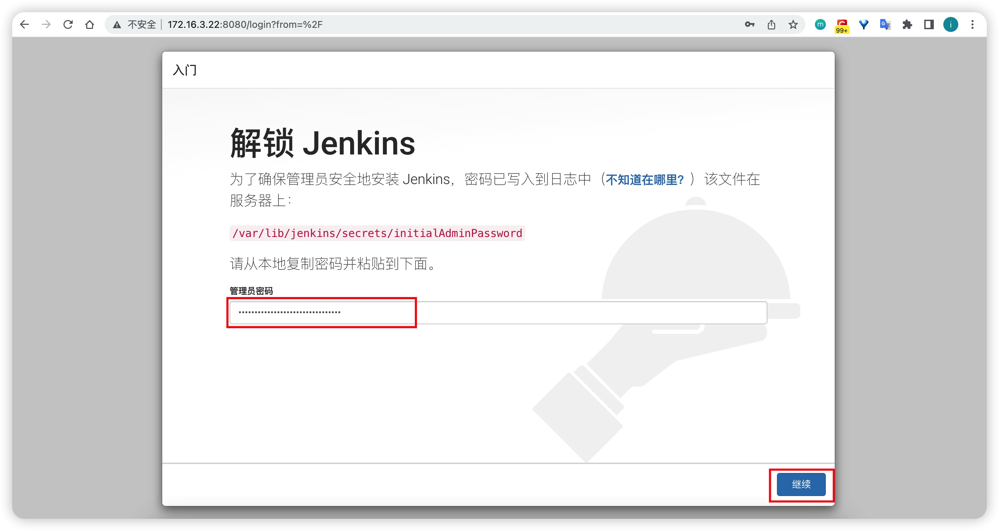
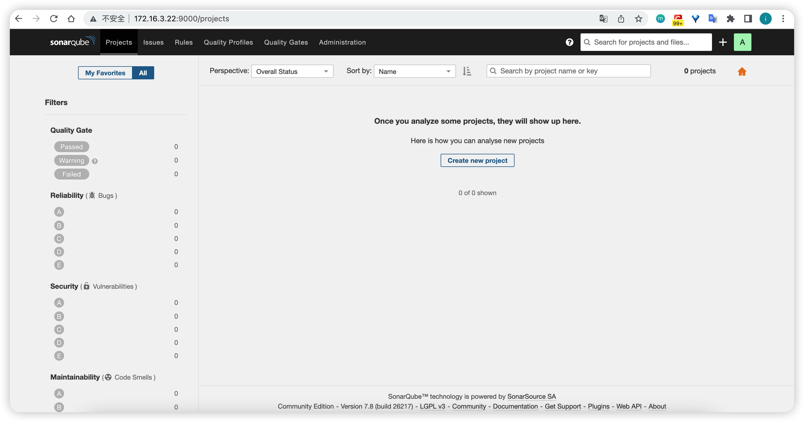
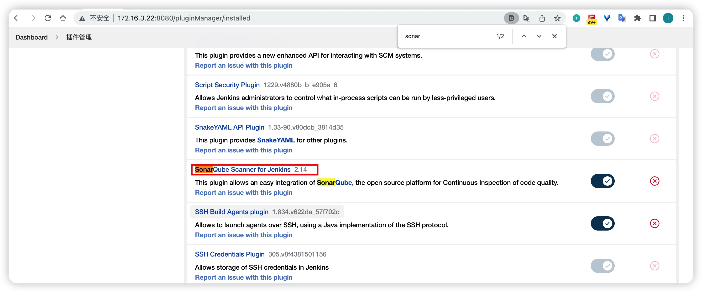
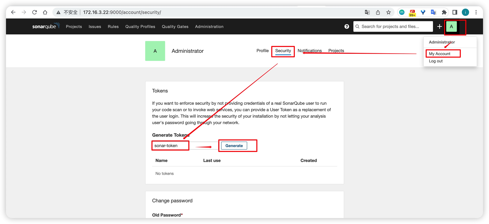
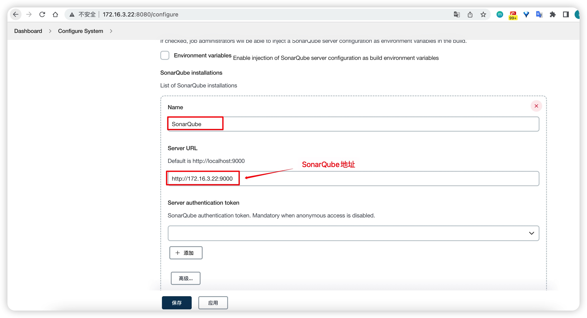
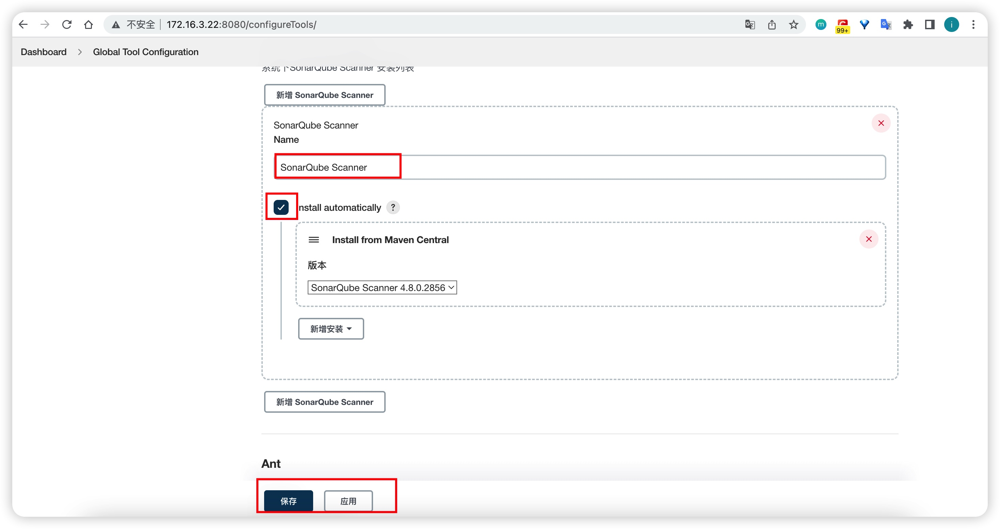
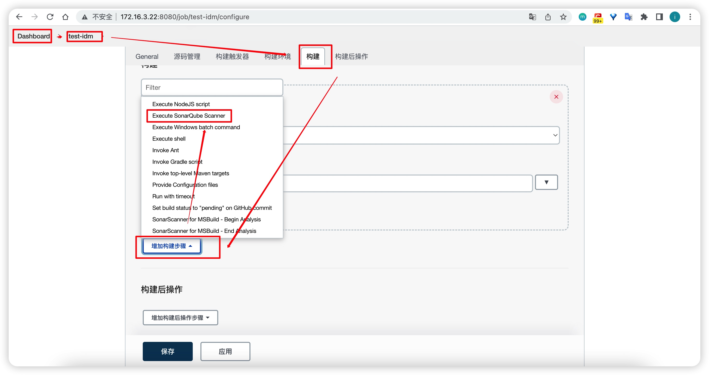
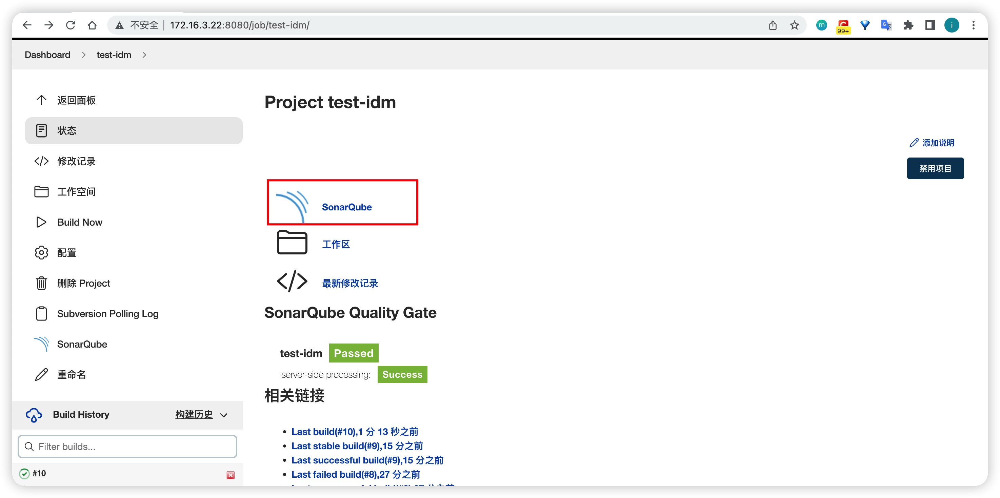
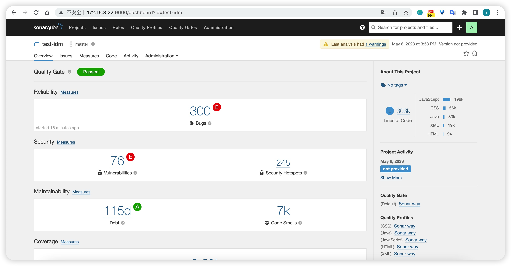

# Docker 构建 Jenkins（docker-compose 部署版本）

Jenkins 是最流行的开源 CI/CD 工具。本文按 docker-compose 方式**一键部署 Jenkins + SonarQube（含 PostgreSQL 数据库）**，替代原 rpm 安装方式。镜像、端口、密码、目录、容器名等全部集中在 `.env` 中管理。

## 1. 宿主目录

| 宿主目录 | 用途 | 容器内用户 |
|---------|------|-----------|
| `/data/runtime/docker/jenkins/home` | Jenkins 主目录（`/var/jenkins_home`） | uid 1000 |
| `/data/runtime/docker/sonarqube/postgres` | SonarQube 数据库数据 | uid 999 |
| `/data/runtime/docker/sonarqube/data` | SonarQube 数据 | uid 999 |
| `/data/runtime/docker/sonarqube/logs` | SonarQube 日志 | uid 999 |
| `/data/runtime/docker/sonarqube/extensions` | SonarQube 插件 | uid 999 |

> 若将 `.env` 中 `*_DIR` 留空，则回退使用 Docker 命名卷，无需创建宿主目录。

## 2. 创建宿主目录并设置权限

bind mount 首次使用需先建目录并授权（jenkins uid 1000、sonarqube/postgres uid 999）：

```bash
mkdir -p /data/runtime/docker/{jenkins/home,sonarqube/{postgres,data,logs,extensions}}
chown -R 1000:1000 /data/runtime/docker/jenkins
chown -R 999:999 /data/runtime/docker/sonarqube
```

## 3. 编制 .env

在本目录创建 `.env` 文件（内容如下，按需修改）：

```bash
# ---------- Jenkins + SonarQube 环境变量（集中管理） ----------

# ===== 镜像配置 =====
JENKINS_IMAGE=jenkins/jenkins:lts-jdk17
SONAR_IMAGE=sonarqube:lts-community
SONAR_POSTGRES_IMAGE=postgres:16.3

# ===== 容器名 =====
JENKINS_CONTAINER_NAME=jenkins
SONAR_CONTAINER_NAME=sonarqube

# ===== 宿主机端口（宿主机:容器）=====
JENKINS_PORT=8080
JENKINS_AGENT_PORT=50000
SONAR_PORT=9000

# ===== SonarQube 数据库密码 =====
SONAR_DB_PASSWORD=sonar

# ===== 宿主机数据目录（统一约定 /data/runtime/docker/<服务>）；留空则回退到命名卷 =====
JENKINS_HOME_DIR=/data/runtime/docker/jenkins/home
SONAR_DB_DIR=/data/runtime/docker/sonarqube/postgres
SONAR_DATA_DIR=/data/runtime/docker/sonarqube/data
SONAR_LOGS_DIR=/data/runtime/docker/sonarqube/logs
SONAR_EXTENSIONS_DIR=/data/runtime/docker/sonarqube/extensions
TZ=Asia/Shanghai
```

## 4. .env 变量说明

| 变量 | 说明 | 示例 |
|------|------|------|
| `JENKINS_IMAGE` | Jenkins 镜像（lts + jdk17） | `jenkins/jenkins:lts-jdk17` |
| `SONAR_IMAGE` | SonarQube 镜像 | `sonarqube:lts-community` |
| `SONAR_POSTGRES_IMAGE` | PostgreSQL 镜像 | `postgres:16.3` |
| `JENKINS_PORT` / `JENKINS_AGENT_PORT` | Jenkins Web / 构建代理端口 | `8080` / `50000` |
| `SONAR_PORT` | SonarQube 端口 | `9000` |
| `SONAR_DB_PASSWORD` | SonarQube 数据库密码 | `sonar` |
| `JENKINS_HOME_DIR` / `SONAR_*_DIR` | 数据目录，留空回退命名卷 | `/data/runtime/docker/jenkins/...` |
| `TZ` | 时区 | `Asia/Shanghai` |

## 5. docker-compose.yml

在本目录创建 `docker-compose.yml`：

```yaml
services:
  postgres:
    image: ${SONAR_POSTGRES_IMAGE}
    container_name: sonarqube-postgres
    restart: always
    environment:
      POSTGRES_USER: sonar
      POSTGRES_PASSWORD: ${SONAR_DB_PASSWORD}
      POSTGRES_DB: sonar
      TZ: ${TZ}
    volumes:
      - ${SONAR_DB_DIR:-sonar-db}:/var/lib/postgresql/data

  sonarqube:
    image: ${SONAR_IMAGE}
    container_name: ${SONAR_CONTAINER_NAME}
    restart: always
    depends_on:
      - postgres
    environment:
      SONAR_JDBC_URL: jdbc:postgresql://postgres:5432/sonar
      SONAR_JDBC_USERNAME: sonar
      SONAR_JDBC_PASSWORD: ${SONAR_DB_PASSWORD}
      TZ: ${TZ}
    ports:
      - "${SONAR_PORT}:9000"
    volumes:
      - ${SONAR_DATA_DIR:-sonar-data}:/opt/sonarqube/data
      - ${SONAR_LOGS_DIR:-sonar-logs}:/opt/sonarqube/logs
      - ${SONAR_EXTENSIONS_DIR:-sonar-extensions}:/opt/sonarqube/extensions

  jenkins:
    image: ${JENKINS_IMAGE}
    container_name: ${JENKINS_CONTAINER_NAME}
    restart: always
    ports:
      - "${JENKINS_PORT}:8080"
      - "${JENKINS_AGENT_PORT}:50000"
    environment:
      TZ: ${TZ}
    volumes:
      - ${JENKINS_HOME_DIR:-jenkins-home}:/var/jenkins_home
      - /etc/localtime:/etc/localtime:ro
      # 如需在容器内构建 Docker 镜像，取消下行注释（把宿主 docker 交给 jenkins 容器）
      # - /var/run/docker.sock:/var/run/docker.sock
      # - /usr/bin/docker:/usr/bin/docker
```

## 6. 启动

```bash
cd Docker构建Jenkins
docker compose up -d       # 启动 Jenkins + SonarQube + PostgreSQL
docker compose ps
docker compose logs -f jenkins
docker compose down        # 停止并移除容器（命名卷数据保留）
docker compose down -v     # 连数据卷一起清空
```

## 7. Jenkins 初始化

Jenkins 默认端口 8080，浏览器访问 `http://{jenkinsServerIP}:8080`：

1. 打开 `/var/jenkins_home/secrets/initialAdminPassword` 获取初始密码并粘贴
2. 安装推荐插件，创建管理员账户
3. 进入「系统管理 / 全局工具设置」配置 JDK / Maven（如容器内需手动安装 jdk/maven，或使用「自动安装」）




## 8. 集成 SonarQube

SonarQube 是开源代码质量管理系统，用于检测代码中的错误、漏洞和代码规范，可与 Jenkins 集成，在项目拉取后进行连续的代码检查。

### 登录 SonarQube

浏览器访问 `http://{sonarServerIP}:9000`，默认账号密码 `admin/admin`（首次登录强制改密）。



### Jenkins 安装 SonarQube Scanner 插件

首页 >> Manager Jenkins(系统管理) >> Manage Plugins(插件管理)，安装 `SonarQube Scanner for Jenkins`。



### 生成 SonarQube 令牌

在 SonarQube 控制台生成 token 并复制保存（后续不可见）。



### 配置 Jenkins 的 SonarQube 信息

Dashboard > Config System，填入 SonarQube 服务器地址与 token。



### 配置 Sonar-scanner

Dashboard > Global Tool Configuration，配置 SonarQube Scanner。



### 构建任务中配置 Sonar Scanner

在构建任务的「构建」步骤添加 `SonarScanner`，指定分析属性（项目 key、源码路径等）。



### 查看扫描结果

执行构建后，可在 SonarQube 控制台查看代码质量报告。




## 9. 常见问题

容器内构建 Maven 时如遇到本地仓库权限报错（`Could not create local repository`），确认 `/var/jenkins_home` 挂载目录属主为 `uid 1000`（jenkins 容器内用户）或调整 `JENKINS_HOME_DIR` 权限：

```bash
mkdir -p /data/runtime/docker/jenkins/home
chown -R 1000:1000 /data/runtime/docker/jenkins
```
