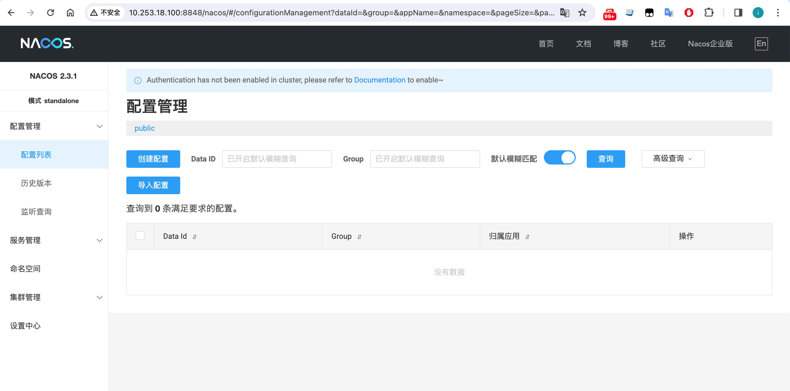

## Docker 构建 Nacos（docker-compose 部署版本）

Nacos 是阿里开源的服务发现 / 配置中心。本文按 docker-compose 方式部署 Nacos（默认 `MODE=standalone`，**内嵌存储、开箱即用、不依赖外部数据库**），镜像、端口、目录、容器名等全部集中在 `.env` 中管理。如需持久化到 MySQL，按文末「MySQL 持久化」配置。

## 1. 宿主目录

| 宿主目录 | 用途 | 容器内用户 |
|---------|------|-----------|
| `/data/runtime/docker/nacos/conf` | 配置文件 | root（容器以 root 运行） |
| `/data/runtime/docker/nacos/logs` | 运行日志 | root |
| `/data/runtime/docker/nacos/data` | 数据目录 | root |

> 若将 `.env` 中 `NACOS_*_DIR` 留空，则回退使用 Docker 命名卷，无需创建宿主目录。

## 2. 创建宿主目录并设置权限

bind mount 首次使用需先建目录（容器以 root 运行，无需授权；如遇权限报错再按容器内 uid 授权）：

```bash
mkdir -p /data/runtime/docker/nacos/{conf,logs,data}
```

## 3. 编制 .env

在本目录创建 `.env` 文件（内容如下，按需修改）：

```bash
# ---------- Nacos 环境变量（集中管理） ----------
NACOS_IMAGE=nacos/nacos-server:2.3.1
NACOS_CONTAINER_NAME=nacos
NACOS_PORT=8848
# 是否开启鉴权（测试环境建议 false）
NACOS_AUTH_ENABLE=false

# 宿主机数据目录（统一约定 /data/runtime/docker/<服务>）；留空则回退到命名卷
NACOS_CONF_DIR=/data/runtime/docker/nacos/conf
NACOS_LOGS_DIR=/data/runtime/docker/nacos/logs
NACOS_DATA_DIR=/data/runtime/docker/nacos/data

# ---------- MySQL 持久化（默认不启用）----------
# 默认 SPRING_DATASOURCE_PLATFORM=，走内嵌存储 standalone。
# 如需持久化到 MySQL：
#   1) 在 MySQL 中先建好 nacos_config 库并导入 nacos-db.sql
#   2) 取消下行注释并填写 MYSQL_SERVICE_* 各项（MYSQL_SERVICE_HOST 填宿主机可达 IP，
#      不能填 localhost，因为 nacos 与 mysql 是不同容器）
# SPRING_DATASOURCE_PLATFORM=mysql
MYSQL_SERVICE_HOST=127.0.0.1
MYSQL_SERVICE_PORT=3306
MYSQL_SERVICE_DB_NAME=nacos_config
MYSQL_SERVICE_USER=root
MYSQL_SERVICE_PASSWORD=ytsl@2021
MYSQL_SERVICE_DB_PARAM=characterEncoding=utf8&connectTimeout=1000&socketTimeout=3000&autoReconnect=true&useSSL=false&allowPublicKeyRetrieval=true
TZ=Asia/Shanghai
```

## 4. .env 变量说明

| 变量 | 说明 | 示例 |
|------|------|------|
| `NACOS_IMAGE` | 镜像版本 | `nacos/nacos-server:2.3.1` |
| `NACOS_CONTAINER_NAME` | 容器名 | `nacos` |
| `NACOS_PORT` | 主端口（gRPC 9848 固定映射） | `8848` |
| `NACOS_AUTH_ENABLE` | 是否开启鉴权（测试环境建议 false） | `false` |
| `NACOS_CONF_DIR` / `_LOGS_DIR` / `_DATA_DIR` | 配置 / 日志 / 数据目录，留空回退命名卷 | `/data/runtime/docker/nacos/...` |
| `TZ` | 时区 | `Asia/Shanghai` |

## 5. docker-compose.yml

在本目录创建 `docker-compose.yml`：

```yaml
services:
  nacos:
    image: ${NACOS_IMAGE}
    container_name: ${NACOS_CONTAINER_NAME}
    restart: unless-stopped
    environment:
      MODE: standalone
      PREFER_HOST_MODE: hostname
      JVM_XMS: 256m
      JVM_XMX: 256m
      NACOS_AUTH_ENABLE: ${NACOS_AUTH_ENABLE}
      # 以下为 MySQL 持久化配置（默认不启用）
      SPRING_DATASOURCE_PLATFORM: ${SPRING_DATASOURCE_PLATFORM}
      MYSQL_SERVICE_HOST: ${MYSQL_SERVICE_HOST}
      MYSQL_SERVICE_PORT: ${MYSQL_SERVICE_PORT}
      MYSQL_SERVICE_DB_NAME: ${MYSQL_SERVICE_DB_NAME}
      MYSQL_SERVICE_USER: ${MYSQL_SERVICE_USER}
      MYSQL_SERVICE_PASSWORD: ${MYSQL_SERVICE_PASSWORD}
      MYSQL_SERVICE_DB_PARAM: "${MYSQL_SERVICE_DB_PARAM}"
      TZ: ${TZ}
    ports:
      - "${NACOS_PORT}:8848"
      - "9848:9848"
    volumes:
      - ${NACOS_CONF_DIR:-nacos-conf}:/home/nacos/conf
      - ${NACOS_LOGS_DIR:-nacos-logs}:/home/nacos/logs
      - ${NACOS_DATA_DIR:-nacos-data}:/home/nacos/data
    healthcheck:
      test: ["CMD-SHELL", "curl -f http://127.0.0.1:8848/nacos/v1/console/health/readiness || exit 1"]
      interval: 10s
      timeout: 5s
      retries: 10

volumes:
  nacos-conf:
  nacos-logs:
  nacos-data:
```

## 6. 启动

```bash
cd Docker构建Nacos
docker compose up -d
docker compose ps
docker compose logs -f nacos
docker compose down        # 停止并移除容器（命名卷数据保留）
docker compose down -v     # 连数据卷一起清空
```

## 7. 验证与登录

浏览器访问: `http://<服务器IP>:8848/nacos`，默认账号密码 `nacos/nacos`（如开启鉴权）。



## 8. MySQL 持久化（可选）

1. 在 MySQL 中新建 `nacos_config` 库，并执行官方脚本 `nacos-db.sql`：https://github.com/alibaba/nacos/blob/master/config/src/main/resources/META-INF/nacos-db.sql
2. 编辑 `.env`，取消 `SPRING_DATASOURCE_PLATFORM=mysql` 一行注释，并填写 `MYSQL_SERVICE_*` 各项
3. 重新启动：`docker compose up -d`

> **注意**：`MYSQL_SERVICE_HOST` 一定要设置为宿主机可达 IP（nacos 与 mysql 是不同容器，不能用 localhost）。
