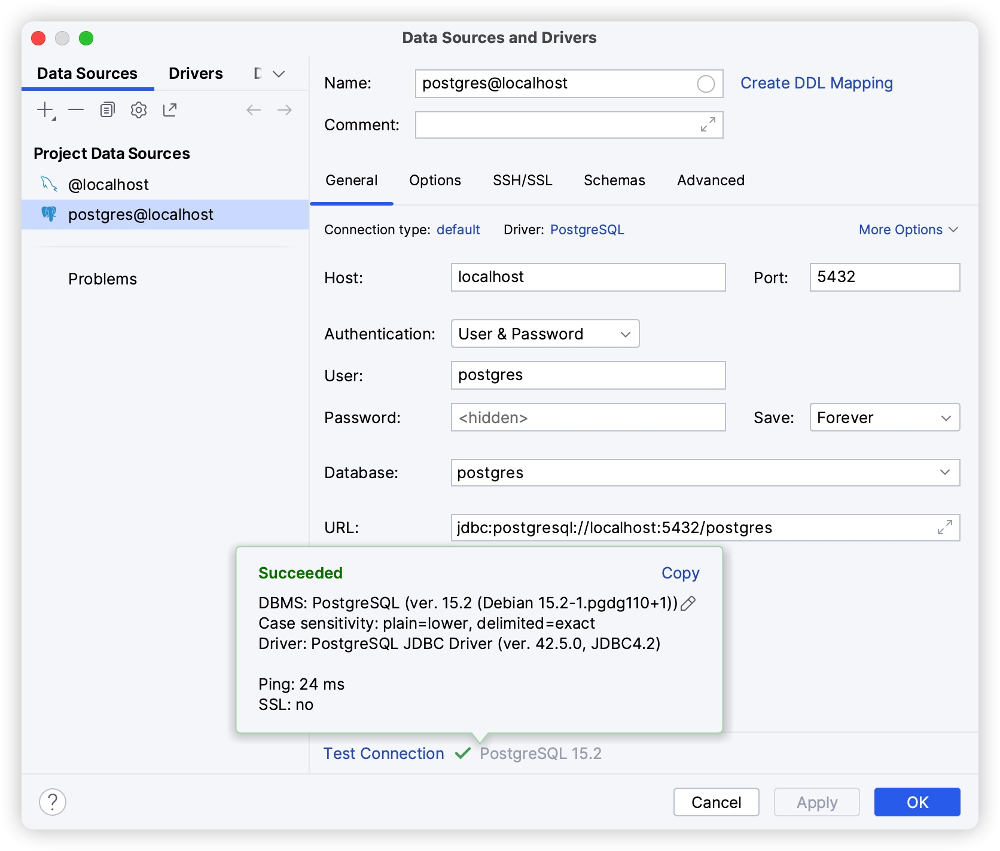

## Docker 构建 PostgreSQL（docker-compose 部署版本）

PostgreSQL 是开源的关系型数据库。本文按 docker-compose 方式部署 PostgreSQL 单节点，镜像、端口、账号、目录、容器名等全部集中在 `.env` 中管理。

## 1. 宿主目录

| 宿主目录 | 用途 | 容器内用户 |
|---------|------|-----------|
| `/data/runtime/docker/postgres/data` | 数据库数据文件 | uid 999 |

> 若将 `.env` 中 `POSTGRES_DATA_DIR` 留空，则回退使用 Docker 命名卷 `postgres-data`，无需创建宿主目录。

## 2. 创建宿主目录并设置权限

bind mount 首次使用需先建目录并授权（容器内 postgres 用户 uid 999）：

```bash
mkdir -p /data/runtime/docker/postgres/data
chown -R 999:999 /data/runtime/docker/postgres
```

## 3. 编制 .env

在本目录创建 `.env` 文件（内容如下，按需修改）：

```bash
# ---------- PostgreSQL 环境变量（集中管理） ----------
POSTGRES_IMAGE=postgres:16.3
POSTGRES_CONTAINER_NAME=postgres
POSTGRES_USER=postgres
POSTGRES_PASSWORD=123456
POSTGRES_DB=postgres
POSTGRES_PORT=5432
# 宿主机数据目录（统一约定 /data/runtime/docker/<服务>）；留空则回退到命名卷 postgres-data
POSTGRES_DATA_DIR=/data/runtime/docker/postgres/data
TZ=Asia/Shanghai
```

## 4. .env 变量说明

| 变量 | 说明 | 示例 |
|------|------|------|
| `POSTGRES_IMAGE` | 镜像版本 | `postgres:16.3` |
| `POSTGRES_CONTAINER_NAME` | 容器名 | `postgres` |
| `POSTGRES_PORT` | 宿主机端口 | `5432` |
| `POSTGRES_USER` / `POSTGRES_PASSWORD` / `POSTGRES_DB` | 账号 / 密码 / 默认库 | `postgres` / `123456` / `postgres` |
| `POSTGRES_DATA_DIR` | 数据目录，留空回退命名卷 | `/data/runtime/docker/postgres/data` |
| `TZ` | 时区 | `Asia/Shanghai` |

## 5. docker-compose.yml

在本目录创建 `docker-compose.yml`：

```yaml
services:
  postgres:
    image: ${POSTGRES_IMAGE}
    container_name: ${POSTGRES_CONTAINER_NAME}
    restart: unless-stopped
    environment:
      POSTGRES_USER: ${POSTGRES_USER}
      POSTGRES_PASSWORD: ${POSTGRES_PASSWORD}
      POSTGRES_DB: ${POSTGRES_DB}
      TZ: ${TZ}
    ports:
      - "${POSTGRES_PORT}:5432"
    volumes:
      - ${POSTGRES_DATA_DIR:-postgres-data}:/var/lib/postgresql/data
    healthcheck:
      test: ["CMD-SHELL", "pg_isready -U ${POSTGRES_USER} -d ${POSTGRES_DB}"]
      interval: 10s
      timeout: 5s
      retries: 10

volumes:
  postgres-data:
```

## 6. 启动

```bash
cd Docker构建PostgreSQL
docker compose up -d
docker compose ps
docker compose logs -f postgres
docker compose down        # 停止并移除容器（命名卷数据保留）
docker compose down -v     # 连数据卷一起清空
```

## 7. 验证

```bash
# 查看运行容器状态
docker ps

# 通过可视化工具（Datagrip 等）连接
# 主机: <服务器IP>  端口: 5432  用户: postgres  密码: 123456
```



