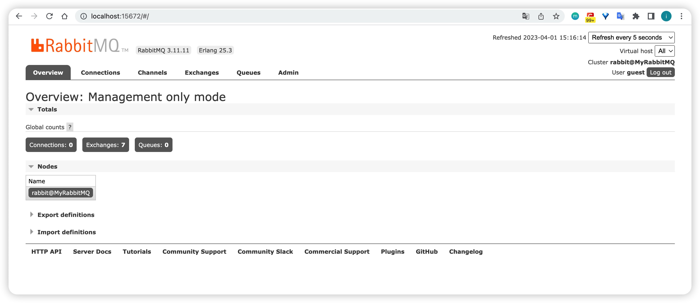

## Docker 构建 RabbitMQ（docker-compose 部署版本）

RabbitMQ 是开源的消息中间件。本文按 docker-compose 方式部署 RabbitMQ（带 management 插件的镜像，**无需手动启用 `rabbitmq_management`**），镜像、端口、账号、目录、容器名等全部集中在 `.env` 中管理。

## 1. 宿主目录

| 宿主目录 | 用途 | 容器内用户 |
|---------|------|-----------|
| `/data/runtime/docker/rabbitmq/data` | 消息数据 | uid 999 |
| `/data/runtime/docker/rabbitmq/conf` | 配置目录 | uid 999 |
| `/data/runtime/docker/rabbitmq/log` | 运行日志 | uid 999 |

> 若将 `.env` 中 `RABBITMQ_DATA_DIR` / `RABBITMQ_CONF_DIR` / `RABBITMQ_LOG_DIR` 留空，则回退使用 Docker 命名卷，无需创建宿主目录。

## 2. 创建宿主目录并设置权限

bind mount 首次使用需先建目录并授权（容器内 rabbitmq 用户 uid 999）：

```bash
mkdir -p /data/runtime/docker/rabbitmq/{data,conf,log}
chown -R 999:999 /data/runtime/docker/rabbitmq
```

## 3. 编制 .env

在本目录创建 `.env` 文件（内容如下，按需修改）：

```bash
# ---------- RabbitMQ 环境变量（集中管理） ----------
RABBITMQ_IMAGE=rabbitmq:3.13-management
RABBITMQ_CONTAINER_NAME=rabbitmq
# RabbitMQ 按节点名（hostname）存储数据，勿随意更改
RABBITMQ_HOSTNAME=rabbitmq
RABBITMQ_DEFAULT_VHOST=/
RABBITMQ_DEFAULT_USER=admin
RABBITMQ_DEFAULT_PASS=admin123456
RABBITMQ_AMQP_PORT=5672
RABBITMQ_MGMT_PORT=15672
# 宿主机数据目录（统一约定 /data/runtime/docker/<服务>）；留空则回退到命名卷
RABBITMQ_DATA_DIR=/data/runtime/docker/rabbitmq/data
RABBITMQ_CONF_DIR=/data/runtime/docker/rabbitmq/conf
RABBITMQ_LOG_DIR=/data/runtime/docker/rabbitmq/log
TZ=Asia/Shanghai
```

## 4. .env 变量说明

| 变量 | 说明 | 示例 |
|------|------|------|
| `RABBITMQ_IMAGE` | 镜像版本（management 版） | `rabbitmq:3.13-management` |
| `RABBITMQ_CONTAINER_NAME` | 容器名 | `rabbitmq` |
| `RABBITMQ_HOSTNAME` | 节点名（RabbitMQ 按节点名存储数据，勿随意改） | `rabbitmq` |
| `RABBITMQ_AMQP_PORT` | 应用访问端口 | `5672` |
| `RABBITMQ_MGMT_PORT` | 控制台 Web 端口 | `15672` |
| `RABBITMQ_DEFAULT_VHOST` / `_USER` / `_PASS` | 默认虚拟机 / 账号 / 密码 | `/` / `admin` / `admin123456` |
| `RABBITMQ_DATA_DIR` / `_CONF_DIR` / `_LOG_DIR` | 数据 / 配置 / 日志目录，留空回退命名卷 | `/data/runtime/docker/rabbitmq/...` |
| `TZ` | 时区 | `Asia/Shanghai` |

## 5. docker-compose.yml

在本目录创建 `docker-compose.yml`：

```yaml
services:
  rabbitmq:
    image: ${RABBITMQ_IMAGE}
    container_name: ${RABBITMQ_CONTAINER_NAME}
    restart: unless-stopped
    hostname: ${RABBITMQ_HOSTNAME}
    environment:
      RABBITMQ_DEFAULT_VHOST: ${RABBITMQ_DEFAULT_VHOST}
      RABBITMQ_DEFAULT_USER: ${RABBITMQ_DEFAULT_USER}
      RABBITMQ_DEFAULT_PASS: ${RABBITMQ_DEFAULT_PASS}
      TZ: ${TZ}
    ports:
      - "${RABBITMQ_AMQP_PORT}:5672"    # 应用访问端口
      - "${RABBITMQ_MGMT_PORT}:15672"   # 控制台 Web 端口
    volumes:
      - ${RABBITMQ_DATA_DIR:-rabbitmq-data}:/var/lib/rabbitmq
      - ${RABBITMQ_CONF_DIR:-rabbitmq-conf}:/etc/rabbitmq
      - ${RABBITMQ_LOG_DIR:-rabbitmq-log}:/var/log/rabbitmq
    healthcheck:
      test: ["CMD", "rabbitmq-diagnostics", "-q", "ping"]
      interval: 10s
      timeout: 5s
      retries: 10

volumes:
  rabbitmq-data:
  rabbitmq-conf:
  rabbitmq-log:
```

## 6. 启动

```bash
cd Docker构建RabbitMQ
docker compose up -d
docker compose ps
docker compose logs -f rabbitmq
docker compose down        # 停止并移除容器（命名卷数据保留）
docker compose down -v     # 连数据卷一起清空
```

## 7. 验证

浏览器请求 `http://localhost:15672`，输入 `.env` 中的账号密码（默认 `admin/admin123456`）。


