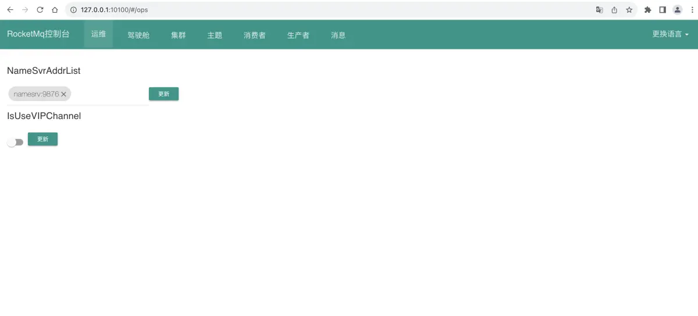

## Docker 构建 RocketMQ（docker-compose 部署版本）

RocketMQ 是阿里巴巴开源的消息中间件。本文按 docker-compose 方式部署 **NameServer（9876）+ Broker（10911/10909）+ Console 控制台（9080）** 三个组件，镜像、端口、目录、容器名等全部集中在 `.env` 中管理。

## 1. 宿主目录

| 宿主目录 | 用途 | 容器内用户 |
|---------|------|-----------|
| `/data/runtime/docker/rocketmq/nameserver/logs` | NameServer 日志 | root（容器以 root 运行） |
| `/data/runtime/docker/rocketmq/nameserver/store` | NameServer 存储 | root |
| `/data/runtime/docker/rocketmq/broker/logs` | Broker 日志 | root |
| `/data/runtime/docker/rocketmq/broker/store` | Broker 存储 | root |
| `/data/runtime/docker/rocketmq/conf` | 配置文件（broker.conf） | 只读 |

> 数据目录：`.env` 中 `ROCKETMQ_*_DIR` 留空则回退使用 Docker 命名卷；**配置目录 `ROCKETMQ_CONF_DIR` 为必填**，需先按第 2 节复制配置。

## 2. 创建宿主目录并设置权限

bind mount 首次使用需先建目录（容器以 root 运行，无需授权）：

```bash
# 1) 配置目录：首次部署把部署包 conf/ 复制到宿主根，之后直接修改宿主目录下的配置
mkdir -p /data/runtime/docker/rocketmq/conf
cp -r ./conf/. /data/runtime/docker/rocketmq/conf/

# 2) 数据目录
mkdir -p /data/runtime/docker/rocketmq/{nameserver,broker}/{logs,store}
```

## 3. 编制 .env

在本目录创建 `.env` 文件（内容如下，按需修改）：

```bash
# ---------- RocketMQ 环境变量（集中管理） ----------
ROCKETMQ_IMAGE=apache/rocketmq:5.3.2
# 官方 Dashboard（旧 styletang/rocketmq-console-ng 已多年未更新，对 5.x 兼容差）
ROCKETMQ_CONSOLE_IMAGE=apacherocketmq/rocketmq-dashboard:1.0.0

# ===== 容器名 =====
ROCKETMQ_NAMESRV_CONTAINER_NAME=rmqnamesrv
ROCKETMQ_BROKER_CONTAINER_NAME=rmqbroker
ROCKETMQ_CONSOLE_CONTAINER_NAME=rmq-dashboard

# ===== 宿主机端口（宿主机:容器）=====
ROCKETMQ_NAMESRV_PORT=9876
ROCKETMQ_BROKER_PORT=10911
ROCKETMQ_BROKER_VIP_PORT=10909
ROCKETMQ_CONSOLE_PORT=9080

# ===== 宿主机数据目录（统一约定 /data/runtime/docker/<服务>）；留空则回退到命名卷 =====
ROCKETMQ_NAMESRV_LOGS_DIR=/data/runtime/docker/rocketmq/nameserver/logs
ROCKETMQ_NAMESRV_STORE_DIR=/data/runtime/docker/rocketmq/nameserver/store
ROCKETMQ_BROKER_LOGS_DIR=/data/runtime/docker/rocketmq/broker/logs
ROCKETMQ_BROKER_STORE_DIR=/data/runtime/docker/rocketmq/broker/store
ROCKETMQ_CONF_DIR=/data/runtime/docker/rocketmq/conf
TZ=Asia/Shanghai
```

## 4. .env 变量说明

| 变量 | 说明 | 示例 |
|------|------|------|
| `ROCKETMQ_IMAGE` | 服务端镜像 | `apache/rocketmq:5.3.2` |
| `ROCKETMQ_CONSOLE_IMAGE` | 控制台镜像 | `apacherocketmq/rocketmq-dashboard:1.0.0` |
| `ROCKETMQ_NAMESRV_PORT` | NameServer 端口 | `9876` |
| `ROCKETMQ_BROKER_PORT` | Broker 端口 | `10911` |
| `ROCKETMQ_BROKER_VIP_PORT` | Broker VIP 端口 | `10909` |
| `ROCKETMQ_CONSOLE_PORT` | 控制台端口 | `9080` |
| `ROCKETMQ_*_DIR` | 数据目录，留空回退命名卷 | `/data/runtime/docker/rocketmq/...` |
| `ROCKETMQ_CONF_DIR` | 配置目录（必填，先复制 conf/） | `/data/runtime/docker/rocketmq/conf` |
| `TZ` | 时区 | `Asia/Shanghai` |

## 5. docker-compose.yml

在本目录创建 `docker-compose.yml`：

```yaml
services:
  namesrv:
    image: ${ROCKETMQ_IMAGE}
    container_name: ${ROCKETMQ_NAMESRV_CONTAINER_NAME}
    restart: unless-stopped
    environment:
      MAX_HEAP_SIZE: 256M
      HEAP_NEWSIZE: 128M
      MAX_POSSIBLE_HEAP: "100000000"
      TZ: ${TZ}
    ports:
      - "${ROCKETMQ_NAMESRV_PORT}:9876"
    volumes:
      - ${ROCKETMQ_NAMESRV_LOGS_DIR:-rmq-namesrv-logs}:/home/rocketmq/logs
      - ${ROCKETMQ_NAMESRV_STORE_DIR:-rmq-namesrv-store}:/root/store
    command: sh mqnamesrv

  broker:
    image: ${ROCKETMQ_IMAGE}
    container_name: ${ROCKETMQ_BROKER_CONTAINER_NAME}
    restart: unless-stopped
    depends_on:
      - namesrv
    environment:
      NAMESRV_ADDR: namesrv:9876
      MAX_POSSIBLE_HEAP: "200000000"
      MAX_HEAP_SIZE: 512M
      HEAP_NEWSIZE: 256M
      TZ: ${TZ}
    ports:
      - "${ROCKETMQ_BROKER_PORT}:10911"
      - "${ROCKETMQ_BROKER_VIP_PORT}:10909"
    volumes:
      - ${ROCKETMQ_BROKER_LOGS_DIR:-rmq-broker-logs}:/root/logs
      - ${ROCKETMQ_BROKER_STORE_DIR:-rmq-broker-store}:/root/store
      - ${ROCKETMQ_CONF_DIR}/broker.conf:/home/rocketmq/broker.conf
    command: sh mqbroker -c /home/rocketmq/broker.conf

  console:
    image: ${ROCKETMQ_CONSOLE_IMAGE}
    container_name: ${ROCKETMQ_CONSOLE_CONTAINER_NAME}
    restart: unless-stopped
    depends_on:
      - namesrv
    environment:
      JAVA_OPTS: "-Drocketmq.namesrv.addr=namesrv:9876 -Dcom.rocketmq.sendMessageWithVIPChannel=false"
      TZ: ${TZ}
    ports:
      - "${ROCKETMQ_CONSOLE_PORT}:8080"

volumes:
  rmq-namesrv-logs:
  rmq-namesrv-store:
  rmq-broker-logs:
  rmq-broker-store:
```

### broker.conf 说明

`conf/broker.conf` 挂载进 broker 容器，关键项：

```properties
brokerClusterName=DefaultCluster
brokerName=broker-a
brokerId=0                     # 0 表示 master，正整数表示 slave
brokerIP1=127.0.0.1            # 内部使用填内网 IP，对外使用填公网 IP（客户端连接必需）
brokerRole=ASYNC_MASTER
flushDiskType=ASYNC_FLUSH
autoCreateTopicEnable=true     # 线下开启，线上关闭
diskMaxUsedSpaceRatio=95
```

> **注意**：`brokerIP1` 必须改为宿主机可达 IP，否则外部客户端无法连接 broker。

## 6. 启动

```bash
cd Docker构建RocketMQ
docker compose up -d       # 启动 NameServer + Broker + Console
docker compose ps
docker compose logs -f broker
docker compose down        # 停止并移除容器（命名卷数据保留）
docker compose down -v     # 连数据卷一起清空
```

## 7. 验证

浏览器访问 RocketMQ 控制台：`http://<服务器IP>:9080`


