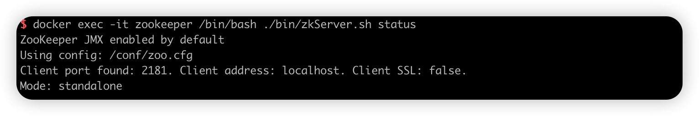

## Docker 构建 ZooKeeper（docker-compose 部署版本）

ZooKeeper 是分布式协调服务。本文按 docker-compose 方式部署 ZooKeeper 单节点，镜像、端口、目录、容器名等全部集中在 `.env` 中管理。

> 如配合 Kafka 使用，建议改用「Docker构建Kafka」中的 KRaft 模式（无需 ZooKeeper）。

## 1. 宿主目录

| 宿主目录 | 用途 | 容器内用户 |
|---------|------|-----------|
| `/data/runtime/docker/zookeeper/data` | 数据快照 | uid 1000 |
| `/data/runtime/docker/zookeeper/conf` | 配置（zoo.cfg 等） | uid 1000 |
| `/data/runtime/docker/zookeeper/logs` | 事务日志 | uid 1000 |

> 若将 `.env` 中 `ZOOKEEPER_*_DIR` 留空，则回退使用 Docker 命名卷，无需创建宿主目录。

## 2. 创建宿主目录并设置权限

bind mount 首次使用需先建目录并授权（容器内 zookeeper 用户 uid 1000）：

```bash
mkdir -p /data/runtime/docker/zookeeper/{data,conf,logs}
chown -R 1000:1000 /data/runtime/docker/zookeeper
```

## 3. 编制 .env

在本目录创建 `.env` 文件（内容如下，按需修改）：

```bash
# ---------- ZooKeeper 环境变量（集中管理） ----------
ZOOKEEPER_IMAGE=zookeeper:3.9.1
ZOOKEEPER_CONTAINER_NAME=zookeeper
ZOOKEEPER_PORT=2181
# 宿主机数据目录（统一约定 /data/runtime/docker/<服务>）；留空则回退到命名卷
ZOOKEEPER_DATA_DIR=/data/runtime/docker/zookeeper/data
ZOOKEEPER_CONF_DIR=/data/runtime/docker/zookeeper/conf
ZOOKEEPER_LOG_DIR=/data/runtime/docker/zookeeper/logs
TZ=Asia/Shanghai
```

## 4. .env 变量说明

| 变量 | 说明 | 示例 |
|------|------|------|
| `ZOOKEEPER_IMAGE` | 镜像版本 | `zookeeper:3.9.1` |
| `ZOOKEEPER_CONTAINER_NAME` | 容器名 | `zookeeper` |
| `ZOOKEEPER_PORT` | 客户端端口 | `2181` |
| `ZOOKEEPER_DATA_DIR` / `_CONF_DIR` / `_LOG_DIR` | 数据 / 配置 / 日志目录，留空回退命名卷 | `/data/runtime/docker/zookeeper/...` |
| `TZ` | 时区 | `Asia/Shanghai` |

> 如需自定义 `zoo.cfg`，可将文件放入 `${ZOOKEEPER_CONF_DIR}`（映射容器 `/conf`）。

## 5. docker-compose.yml

在本目录创建 `docker-compose.yml`：

```yaml
services:
  zookeeper:
    image: ${ZOOKEEPER_IMAGE}
    container_name: ${ZOOKEEPER_CONTAINER_NAME}
    restart: unless-stopped
    ports:
      - "${ZOOKEEPER_PORT}:2181"
    volumes:
      - ${ZOOKEEPER_DATA_DIR:-zk-data}:/data
      - ${ZOOKEEPER_CONF_DIR:-zk-conf}:/conf
      - ${ZOOKEEPER_LOG_DIR:-zk-datalog}:/datalog
    healthcheck:
      test: ["CMD-SHELL", "echo ruok | nc 127.0.0.1 2181 | grep imok"]
      interval: 10s
      timeout: 5s
      retries: 10

volumes:
  zk-data:
  zk-conf:
  zk-datalog:
```

## 6. 启动

```bash
cd Docker构建ZooKeeper
docker compose up -d
docker compose ps
docker compose logs -f zookeeper
docker compose down        # 停止并移除容器（命名卷数据保留）
docker compose down -v     # 连数据卷一起清空
```

## 7. 验证

```bash
docker exec -it zookeeper /bin/bash ./bin/zkServer.sh status
# 输出 ZooKeeper JMX enabled by default / Mode: standalone 即正常
```


