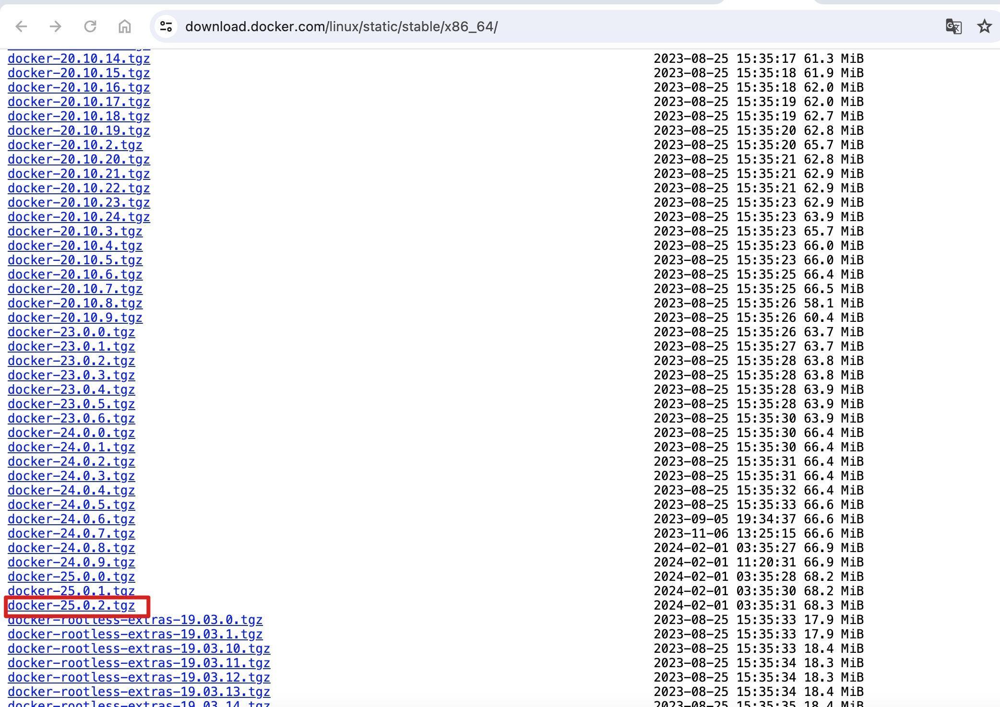
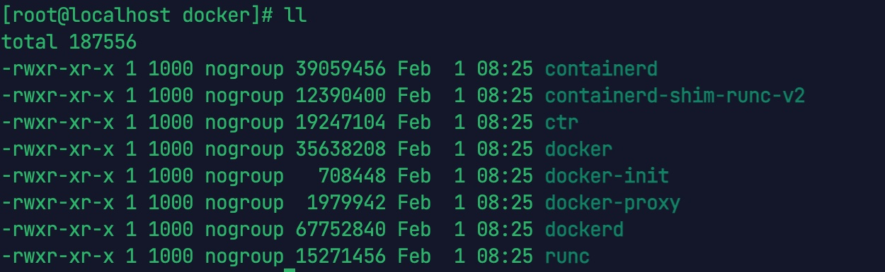
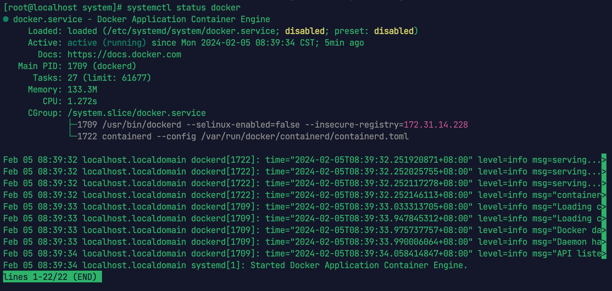
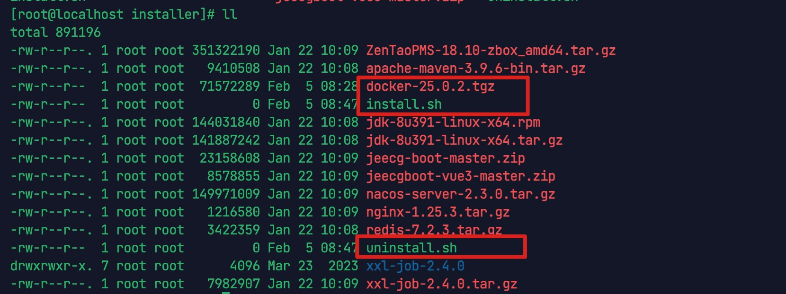

## 1. 安装准备

下载 docker 离线安装包，下载地址如下：

[Index of Linux/static/stable/x86_64/](https://download.docker.com/linux/static/stable/x86_64/)

这里我们选择安装最新版本`docker-25.0.2.tgz`。



## 2. 分步安装法

### 2.1 解压缩

```bash
tar -zxvf docker-25.0.2.tgz
```

解压后的文件夹 docker 中文件如下所示：



### 2.2 复制文件

将 docker 中的全部文件，使用下面命令，复制到/usr/bin

```bash
cp ./docker/* /usr/bin
```

### 2.3 创建 docker.service 文件

```bash
vi /etc/systemd/system/docker.service
```

然后将下面内容复制到 docker.service。

```ini
[Unit]
Description=Docker Application Container Engine
Documentation=https://docs.docker.com
After=network-online.target firewalld.service
Wants=network-online.target
[Service]
Type=notify
# the default is not to use systemd for cgroups because the delegate issues still
# exists and systemd currently does not support the cgroup feature set required
# for containers run by Docker
ExecStart=/usr/bin/dockerd
ExecReload=/bin/kill -s HUP $MAINPID
# Having non-zero Limit*s causes performance problems due to accounting overhead
# in the kernel. We recommend using cgroups to do container-local accounting.
LimitNOFILE=infinity
LimitNPROC=infinity
LimitCORE=infinity
# Uncomment TasksMax if your systemd version supports it.
# Only systemd 226 and above support this version.
#TasksMax=infinity
TimeoutStartSec=0
# set delegate yes so that systemd does not reset the cgroups of Docker containers
Delegate=yes
# kill only the Docker process, not all processes in the cgroup
KillMode=process
# restart the Docker process if it exits prematurely
Restart=on-failure
StartLimitBurst=3
StartLimitInterval=60s
[Install]
WantedBy=multi-user.target
```

 编辑好后，按 ESC 键后输入 :wq 保存并退出 docker.service 文件。

### 2.4 添加可执行权限

```bash
chmod +x /etc/systemd/system/docker.service
```

### 2.5 加载 docker.service

```bash
systemctl daemon-reload
```

注意，若修改了 docker.service 文件，则要重新加载该文件。

### 2.6 启动 docker

```bash
## 启动docker
systemctl start docker

## 设置开机启动
systemctl enable docker.service
```

### 2.7 查看 docker

```bash
systemctl status docker
```



```bash
docker -v
```

 

## 3. 一键安装法

如果您觉得上面的步骤繁琐，也可以用下面的办法，一键安装 docker。

### 3.1 制作 docker.service 文件

在 docker-25.0.2.tgz 同目录下，创建 docker.service，打开编辑文件，文件内容与 2.3 节完全一样，此处不再赘述。

### 3.2 制作一键安装脚本

```bash
touch install.sh
```

打开编辑 install.sh，将以下内容复制到 install.sh，保存退出。

```bash
#!/bin/sh
echo '解压tar包'
tar -xvf $1
echo '将docker目录下所有文件复制到/usr/bin目录'
cp docker/* /usr/bin
echo '将docker.service 复制到/etc/systemd/system/目录'
cp docker.service /etc/systemd/system/
echo '添加文件可执行权限'
chmod +x /etc/systemd/system/docker.service
echo '重新加载配置文件'
systemctl daemon-reload
echo '启动docker'
systemctl start docker
echo '设置开机自启'
systemctl enable docker.service
echo 'docker安装成功'
docker -v
```

### 3.3 制作一键卸载脚本

touch uninstall.sh，将以下内容复制到 uninstall.sh，保存退出。

```bash
#!/bin/sh
echo '停止docker'
systemctl stop docker
echo '删除docker.service'
rm -f /etc/systemd/system/docker.service
echo '删除docker文件'
rm -rf /usr/bin/docker*
echo '重新加载配置文件'
systemctl daemon-reload
echo '卸载成功'
```

### 3.4 安装 docker

此时 docker-25.0.2.tgz 同目录下，还有上面创建的 docker.service，install.sh，uninstall.sh 这 3 个文件：



分别给 install.sh 和 uninstall.sh 赋予可执行权限。

```bash
chmod +x install.sh
chmod +x uninstall.sh
```

开始安装

```bash
sh install.sh docker-25.0.2.tgz
```

### 3.5 查看 docker 状态


### 3.6 安装 Docker Compose 插件

本目录下各中间件均采用 `docker compose` 部署，需额外安装 compose 插件：

```bash
# 下载 docker compose 插件到 /usr/local/lib/docker/cli-plugins（Docker 25 起默认目录）
mkdir -p /usr/local/lib/docker/cli-plugins
curl -SL "https://github.com/docker/compose/releases/latest/download/docker-compose-$(uname -s)-$(uname -m)" -o /usr/local/lib/docker/cli-plugins/docker-compose
chmod +x /usr/local/lib/docker/cli-plugins/docker-compose

# 验证
docker compose version
```

> 若为旧版 docker-compose（独立二进制），可下载到 `/usr/bin/docker-compose` 后以 `docker-compose` 命令使用，但建议统一使用 `docker compose` 子命令。

